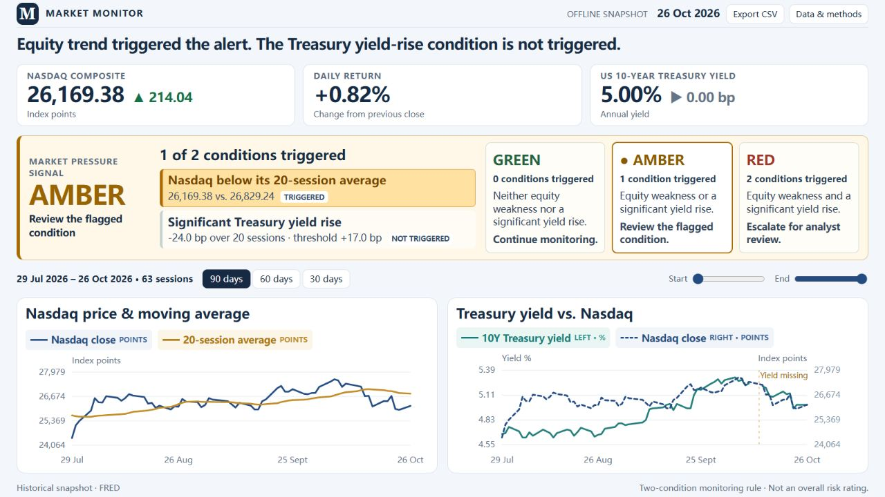
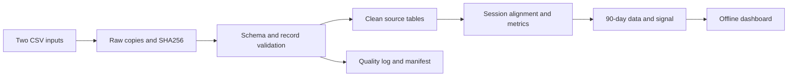

# Market Monitor: Nasdaq and US Treasury

## [Open the interactive dashboard](https://jimqhw.github.io/Busa3022-assignment2/dashboard.html)

View the published dashboard directly in your browser. The page uses the supplied historical snapshot dated 26 October 2026.

BUSA3022 Assignment 2 technical portfolio for the fictional Really Big Bank post-trade team: **How has the market trended over the past 90 days, and what deserves attention?**

## Use

Open **dashboard.html** in a browser. No installation, server or internet connection is required. Filter charts, inspect values, export CSV, and open Data & methods for definitions. Cards and the signal remain at the latest snapshot date.

To rebuild with Python 3.10 or later (standard library only):

```sh
python run.py --open
python run_tests.py
```

Windows can use `py -3` instead of `python`. Tests save actual results in docs/test_results.txt. Each build creates a separate evidence folder.



## Assessment evidence

| Requirement | Artifact |
|---|---|
| Part 1: repeatable pipeline, architecture, failures | Plan below; pipeline.py; manifest and quality_events.csv |
| Part 2: metric definitions before coding | docs/metric_requirements.md, the original specification |
| Part 2: working calculations and quality | pipeline.py; dashboard.py; tests; curated CSVs |
| Part 3: price with average, macro overlay, RAG | dashboard.html; web/; signal specification below |
| AI and leadership lenses | Reflection and handoff below; initial and current test logs |

The written assessment, cover sheet, GitHub URL and presentation of at most 10 minutes are separate deliverables.

## Data

Supplied originals are data/raw/DGS10.csv and NASDAQCOM.csv, covering 26 October 2021 through 26 October 2026. DGS10 is the Federal Reserve Board's ten-year Treasury constant-maturity yield. NASDAQCOM is Nasdaq, Inc.'s Composite closing index. Both share FRED as distributor; they are two upstream series, not independent distribution platforms.

The reviewed calculation interval is 1 April through 26 October 2026 (144 Nasdaq sessions). The displayed 90 calendar days, 29 July through 26 October, contain 63 sessions. There is no live acquisition or bank-performance dataset.

## Part 1: pipeline plan and proof of concept



The working slice ingests both local files repeatedly. Exact raw bytes, clean tables and curated tables are separate. Profiles reconcile valid, missing and rejected rows. Invalid dates, nonfinite numbers, invalid index values and duplicates are logged; original records remain in raw storage. Conflicting duplicates, changed schema and missing expected market sessions block publication rather than silently choosing values.

The wrapper uses a run lock. Data success updates outputs/latest.json; complete dashboard generation updates outputs/dashboard_latest.json, which identifies the displayed version. A failed build retains the previous HTML until replacement is generated. A dashboard failure after data success can leave the pointers different; investigate the error rather than assuming the newest data was displayed.

Production proposal: acquire both series at 08:00 America/New_York on business days, checking actual release availability and freshness. A named timezone handles daylight saving. Store request metadata and original responses, apply bounded timeouts and retries, and validate before publishing. On exhausted retries or changed schema, retain the last good publication, mark it stale and alert the operator. Network acquisition, scheduling and automated alerts are proposed, not implemented.

## Part 2: curation and standards

Use one unique ascending ISO date per scheduled Nasdaq session. Date labels are US observations, not timestamps: do not shift them to Sydney or reinterpret them as UTC midnight. Store ingestion timestamps in UTC. Retrospective same-date alignment does not establish simultaneous availability; decision-time use would need release timestamps and vintages.

Left join yields to the reviewed 2026 Nasdaq session calendar; early-close dates count. Missing yields remain null with an explicit flag and visible gap. The index exists on 12 October but yield is missing: keep the market record. Missing scheduled prices block rather than bridge returns. Do not fill values or substitute zero.

| Active measure | Definition |
|---|---|
| MA20 | Current-inclusive mean of 20 scheduled closes; all required. Shows price trend. |
| Daily index return | Current / previous scheduled close - 1; stored as a fraction, displayed as %. |
| 20-session yield change | (Current yield - yield 20 Nasdaq sessions earlier) x 100 basis points; both endpoints required. Shows rate pressure. |

Index and MA20 use points. Source yield 5.00 means 5.00%; one percentage point equals 100 bp. Missing CSV numerics are blank; booleans are True/False. Calculate before selecting the 90-day display to preserve warm-up history. Legacy volatility remains in pipeline output for compatibility but is not an active dashboard measure. The original pre-code specification is retained and marked historical.

## Part 3: signal and design

The audience is financially literate and non-technical. A single conclusion, large values and a highlighted triggered condition communicate the priority. Charts show 90-day price with MA20 and yield alongside equities on separately labelled axes. Blue consistently denotes Nasdaq; the macro panel uses a dashed index line. Details live in a dialog. Visual co-movement does not imply causation.

Condition A: Nasdaq close is strictly below MA20. Equality does not trigger.

Condition B: the 20-session yield change is positive and at least the pre-display historical P80 threshold, floored at zero. Missing either endpoint makes B unavailable. Intermediate missing yields are not filled and do not invalidate an endpoint difference. Require 40 prior calibration observations; use linear interpolation at `(n-1)*p`. Normalise changes to ten decimal places in bp to remove subtraction noise; classify before display rounding.

For this snapshot, 61 changes from 30 April through 28 July produce a **17 bp** threshold. No displayed-period changes calibrate it. P80 is a pragmatic upper-tail watch threshold, not a validated predictive model; longer history and workload review would be needed before production.

| Triggered conditions | Signal | Action |
|---|---|---|
| Neither | GREEN | Monitor |
| Exactly one | AMBER | Review the flagged condition |
| Both | RED | Escalate for analyst review |
| Either unavailable | UNAVAILABLE | Check missing observations |

Latest close 26,169.38 is below MA20 26,829.241. Yield moved from 5.24% on 28 September to 5.00%, a **-24 bp** change over 20 sessions. Only A triggers: **AMBER**. Display counts are 19 green, 34 amber, 9 red and 1 unavailable. signal_observations.csv preserves each decision.

Adjacent arrows show previous scheduled-session changes: index points and yield basis points. Green means numerical increase, red decrease, grey unchanged; these direction colours are independent of pressure classification. Missing comparisons show a dash. Filters do not recalibrate the latest signal. The rule describes one pressure scenario, not all market risks or a trading recommendation.

## AI reflection and handoff

Code, tests and documentation used OpenAI Codex assistance. Original metric requirements were recorded before transformation code; acknowledge assistance according to course instructions.

An actual initial AI-generated test harness used an unwritable default temporary directory, causing four permission failures. The initial tracebacks are retained in docs/test_results_initial.txt. The fix used bounded project-local temporary folders; tests were rerun. This was a portability error, not a financial formula error. Deliberately injected schema failures are tests, not real production incidents.

Actual user-driven iteration replaced a long page with a one-screen overview, larger legends, a single conclusion and explicit threshold/action cards. The volatility-only signal was replaced with dual conditions to connect both datasets. The highlighted flag and current values explain why the customer should pay attention.

A junior analyst validates inputs, runs the build, reconciles quality counts, checks the manifest and dashboard pointer, confirms dates and units, and runs tests after changes. The lead approves calendar, schema, metric and threshold changes. AI-generated changes receive the same independent numeric checks and review. Retain failure evidence and investigate missing prices. Verify no job is active before clearing a stale .run.lock. Prioritise correctness and reproducibility over more series or hosting.

## Files and updates

web/ contains page sources; tests/ contains formula and failure checks; data/raw/ contains original inputs. outputs/ retains one complete current run for submission, including raw copies and rendered HTML for provenance. Later local builds create additional runs.

```sh
python run.py --input-dir "path/to/csv/folder" --open
```

New inputs require the same filenames and headers. Only the 2026 calculation calendar is reviewed; other years deliberately fail until reviewed. Snapshot tests expect supplied baseline inputs.

Sources: [DGS10](https://fred.stlouisfed.org/series/DGS10), [NASDAQCOM](https://fred.stlouisfed.org/series/NASDAQCOM), [Nasdaq calendar](https://www.nasdaqtrader.com/trader.aspx?id=calendar), and the course-supplied Analytics Lead Case Study. Third-party data rights remain with the providers; no redistribution licence for Nasdaq data is asserted.
